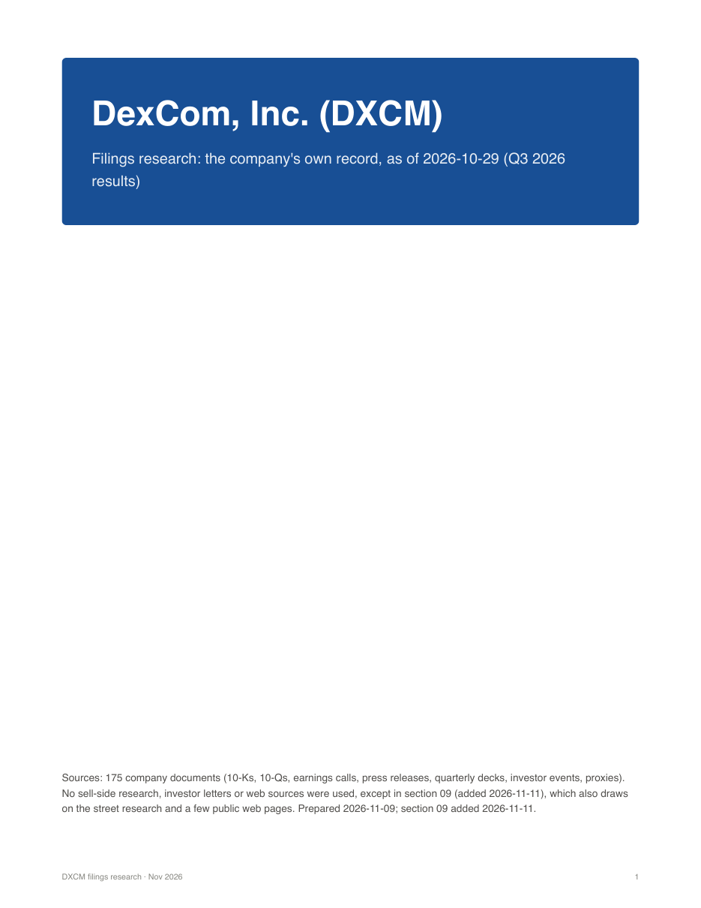
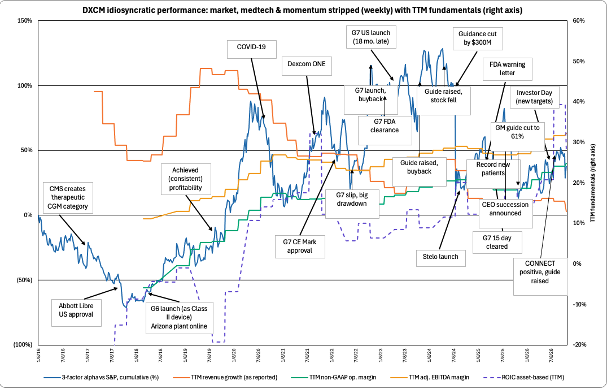
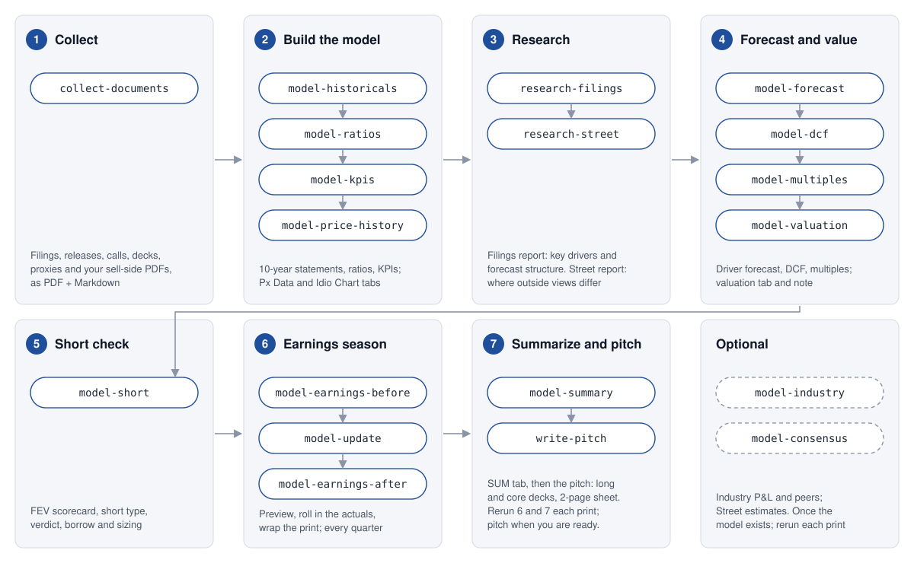

# buyside-analyst-skills

Claude Code skills for fundamental equity research. They collect a company's documents, build its Excel model, write
research reports from its filings and from the Street, forecast the business and value the stock.

## Why

Most of the time on a new idea goes to mechanical work: pulling ten years of filings, typing the historical model,
reading every call and deck, and checking that the numbers tie. These skills do that work. The analyst keeps the
judgment calls: which drivers matter, what the forecast assumes, what the stock is worth. Every number Claude types
into the model is checked by code against the line in the source document it came from, and a number that fails the
check is not written. Each typed cell carries a source note.

## What you get

A full run on DexCom (DXCM) is in [`examples/DXCM/`](examples/DXCM/): the finished model and the filings research
report.


*The MOD tab: 10 years of quarterly and annual statements, with growth, margins and returns under each line.*


*The filings research report (summary and a revenue page): about 100 cited pages from the company's own documents.*


*The Idio Chart tab: price, valuation and stock-specific (idiosyncratic) moves against fundamentals.*


*The Consensus tab: broker ratings, price targets, estimates and rating history.*

## Workflow



| # | Skill | What it does | Needs first | Adds |
|---|---|---|---|---|
| 1 | collect-documents | Collects every raw document for the company | Nothing | 10-Ks, 10-Qs, releases, calls, decks, events, proxies, and the sell-side PDFs you drop in, as PDF + Markdown |
| 2 | model-historicals | Builds the historical model | collect-documents (runs it if missing) | 10-year quarterly + annual income statement, balance sheet, cash flow (MOD tab) |
| 3 | model-ratios | Analyzes the historicals | model-historicals | Growth, margins, ROIC / ROE / ROA, leverage, cash conversion, FCF inside MOD |
| 4 | model-kpis | Backfills non-GAAP and company KPIs | model-ratios | Non-GAAP reconciliations and company-specific operating metrics |
| 5 | model-price-history | Ties the stock price to fundamentals | model-kpis | Px Data, Px Events, Idio Chart tabs (daily prices from Yahoo) |
| 6 | research-filings | Researches the company from its own documents only | steps 1-5 | PDF report; key drivers; recommended forecast structure; Filings Charts tab |
| 7 | research-street | Compares outside views with the company's claims | research-filings | PDF report on where the sell-side and investors differ, and why |
| 8 | model-forecast | Builds the forecast from the key drivers | research-filings (research-street if done) | Driver-based quarterly 3-statement forecast in MOD (you approve the plan first) |
| 9 | model-dcf | Values the company | model-forecast, model-price-history | 30-year key-driver DCF and reverse DCF; you own the inputs |
| 10 | model-multiples | Shows where the stock trades | model-forecast | Multiples tab: history, vs S&P, vs peers, ranges, reverse P/E, forward table, comp sheet with Include? toggles, P/E-vs-growth line through the peers, P/E vs core-peer median chart |
| 11 | model-valuation | Says what it's worth and whether the setup is worth owning | model-dcf, model-multiples | Valuation tab: the agent's Buy / Hold / Sell verdict at the top, 1-3 multiples with reasons, 12-month R/R per multiple and blended, R/R ladder, 3-year IRR and the 3 R's, DCF bear / base / bull from an agent-run reverse DCF, probability tree; valuation note |
| 12 | model-short | Checks whether there's a short, and what kind | model-valuation | Short Check tab: FEV scorecard with code and agent ticks, short type and alpha bucket, verdict against a fixed rule, subpar-algorithm IRR wedge, risk case and R/R, print move, short interest, borrow drag, VaR max position; short note |
| 13 | model-earnings-before | Prepares for the next print | model-valuation (model-consensus if done) | Earnings tab: the call and a stance by a fixed rule, print risk / reward and implied PSUC, set-up and blow-up flags, model checks on the quarter (stacks, seasonality, hockey stick), base rates and implied move, guidance trail, variance grid (fills the Consensus table, asking first if you typed in it), frozen forecast; preview note |
| 14 | model-update | Rolls the reported quarter into the model | the print (model-earnings-before before it) | The quarter's actuals in MOD from the earnings release, each matched to its row, tied out and noted; lines the release doesn't print keep the old forecast in orange placeholders until the 10-Q rerun fills them; restated history only on your yes; new guidance recorded for Filings Charts; a targeted forecast roll after a thesis read, which you approve as a was-to-now table; ends with the list of skills to rerun |
| 15 | model-earnings-after | Wraps the print | the call and model-update (then the reruns it lists) | Earnings tab bands 9-15: actual vs the frozen forecast, SFOT, the move in sigmas against the expected and implied move, estimates and valuation before and after, IRR at today's price, guidance and long-term target pace, the thesis checkpoint and a react call; Call Notes tab (quarters side by side, near-verbatim lines with file:line); after-print note in Earnings Reviews; rerun at T+7 for the drift |
| 16 | model-summary | The PM's one-page SUM tab, first in the workbook | model-valuation (rerun each print) | SUM tab, the first sheet: the PM's one-page view. Cap table with 3M ADV, NTM FCF yield, 3-year target and IRR, 12-month base and risk on the primary multiple, internal estimates vs Street on the Street's own basis (GAAP or non-GAAP by evidence, margins in bps) with Expected Delta and multiples per year, the probability tree, multiple ranges, the tactical R/R ladder. Every number links to its home tab; empty yellow boxes for write-pitch; conditional formatting on returns, IRR, R/R and Street variance |
| – | model-industry | Builds the industry view (optional) | the model; research-filings | Industry P&L and Industry Comparison tabs from public peers |
| – | model-consensus | Tracks the Street (optional) | the model; research-street | Broker ratings, targets, estimates, rating history, consensus snapshots |

## Naming convention

| Prefix | What it produces |
|---|---|
| `collect-` | Raw material: documents on disk |
| `model-` | Additions to the Excel model |
| `research-` | A written research report (PDF) |
| `write-` | A deliverable such as a pitch deck (roadmap) |

## Design principles

- **Every number is sourced and checked.** A typed number carries a note with its file and line, and code confirms
  the number is printed on that line. Formulas stay live formulas.
- **The analyst decides.** You approve the forecast plan before your file changes, and you own every valuation input
  in the DCF.
- **Any company.** Nothing in the scripts or prompts is specific to one company. DXCM is only the example.
- **Your edits are safe.** A skill never overwrites changes you made to the model. If the file changed during a
  build, it stops and rebuilds.
- **Every judgment call is reported.** When a skill has to choose (a conflict between sources, an estimate, a
  reading of your notes), it decides, keeps going, and tells you.

## Install

In Claude Code:

```
/plugin marketplace add kghoff/buyside-analyst-skills
/plugin install buyside@buyside-analyst-skills
```

Commands are `/buyside:<skill> TICKER`, e.g. `/buyside:collect-documents DXCM`.

### One-time setup

1. Python packages: `pip install -r requirements.txt`
2. Node packages: run `npm install` inside `skills/collect-documents`, `skills/model-consensus`,
   `skills/model-short`, `skills/model-price-history`, `skills/model-multiples`, `skills/model-earnings-before` and
   `skills/model-earnings-after` in the installed plugin folder (`/plugin` shows where it is).
3. LibreOffice (recalculates and renders the workbooks): `brew install --cask libreoffice`
4. PDF, OCR and report tools: `brew install poppler tesseract pango` (pango is needed by WeasyPrint)
5. Google Chrome, used to save web pages as PDFs.
6. The settings file: copy `settings.example.json` to `~/.config/buyside-analyst/settings.json` and fill it in.

| Setting | Required? | What it is |
|---|---|---|
| `sec_contact` | Yes | Your name and email. The SEC asks every client to identify itself. |
| `research_dir` | Yes (has a default) | Where each ticker's folder and model go |
| `alpha_vantage_keys` | No | Free Alpha Vantage API keys. Without one, call transcripts are skipped. |
| `chrome_path` | Yes (has a default) | Path to Google Chrome |
| `xbrl_cli` | Only for model-industry | Path to the separate [edgar-xbrl-financials](https://github.com/kghoff/edgar-xbrl-financials) tool's `bin/cli.js`, which supplies peer financials |

**Sell-side reports.** The tools never download broker research. Drop the reports you have access to into
`<research_dir>/<TICKER>/Sellside Research/` and collect-documents files and converts them. research-street and
model-consensus use them.

## Quick start

One ticker through the chain. Each skill tells you what it decided when it finishes.

| Step | Command | Pauses to ask you |
|---|---|---|
| 1 | `/buyside:collect-documents TICKER` | Nothing. Drop sell-side PDFs into `Sellside Research/` before or after and rerun to file them. |
| 2 | `/buyside:model-historicals TICKER` | Only if the company changed its business segments (how to handle the recast) |
| 3 | `/buyside:model-ratios TICKER` | Only if the analysis is already there (replace it?) |
| 4 | `/buyside:model-kpis TICKER` | Only if the sections are already there (rebuild?) |
| 5 | `/buyside:model-price-history TICKER` | GAAP or non-GAAP margins for the overlays. Prices download from Yahoo; only if Yahoo fails does it wait while you download the free price files from stooq |
| 6 | `/buyside:research-filings TICKER` | The as-of date and any notes or questions you have; at the end, whether to run model-forecast |
| 7 | `/buyside:research-street TICKER` | The as-of date and your notes or questions |
| 8 | `/buyside:model-forecast TICKER` | Your notes for the forecast; then your approval of the forecast plan |
| 9 | `/buyside:model-dcf TICKER` | Nothing. Fill in the yellow input cells yourself. |
| 10 | `/buyside:model-multiples TICKER` | How you get peer and market data (free or paid); which comps to use |
| 11 | `/buyside:model-valuation TICKER` | Nothing. The agent's choices are yellow cells you own; change any and a rerun keeps it. |
| 12 | `/buyside:model-short TICKER` | Your prime broker's borrow rate if you know it. The agent's choices are yellow cells you own. |
| 13 | `/buyside:model-earnings-before TICKER` | Only if you typed in the Consensus variance table (overwrite it?), or a same-quarter rerun would clear the after-print wrap |
| 14 | `/buyside:model-update TICKER` | Restated history (update it?); your approval of the forecast roll |
| 15 | `/buyside:model-earnings-after TICKER` | Only if the call transcript isn't posted yet (save it yourself or stop). Rerun at T+7 for the drift. |
| 16 | `/buyside:model-summary TICKER` | Nothing. The yellow cells (Street EPS basis, the bands, the write-pitch boxes) are yours; a rerun keeps them. |
| opt | `/buyside:model-industry TICKER` | Which peers to include |
| opt | `/buyside:model-consensus TICKER` | Nothing; rerun after each earnings print |

Every skill asks you to close the model in Excel if it is open.

## Limitations

- **Not for banks, insurers or REITs.** model-historicals stops on them.
- **Per-broker estimates come only from reports you have.** Ratings and price targets are free; each broker's own
  estimates need its report in `Sellside Research/`.
- **Mac-first.** Setup uses Homebrew, and the default Chrome path is the macOS one.
- **Output is Excel workbooks and PDF reports.**
- **It takes time and Claude usage.** Each skill takes minutes to an hour and dispatches Claude subagents, which
  counts against your Claude usage.

## Roadmap

- `write-pitch-deck`: turn the model and research into a pitch deck.
- `write-thesis`: write the investment thesis.

## About

Built by Kyle Hoff ([LinkedIn](https://www.linkedin.com/in/kyle-hoff-engineer)). MIT license; see [LICENSE](LICENSE).
