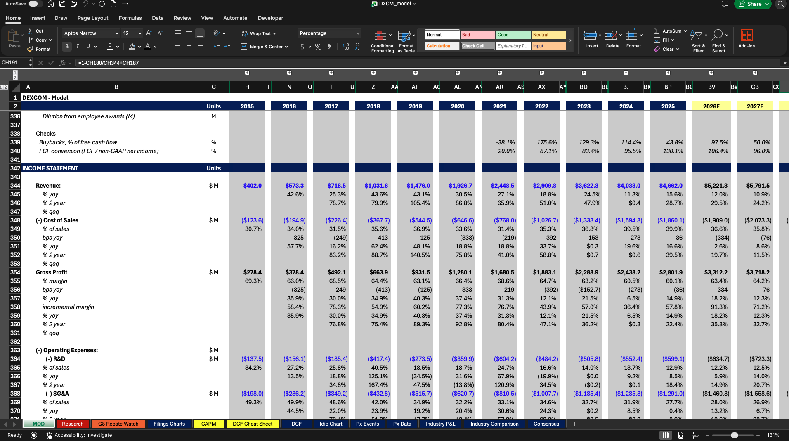
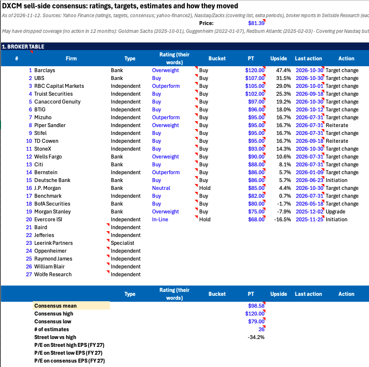

# buyside-analyst-skills

Claude Code skills for the fundamental buyside analyst. Speed up the thesis development workflow - modeling, research, valuation, pitch deck assembly, etc

## Why

Most of the hours in a new idea go to grunt work: pulling ten years of filings, typing the historical model, reading
every call and deck, and checking that the numbers tie. I built these skills so Claude does that work and I keep
every judgment: which drivers matter, what the forecast assumes, what the stock is worth. Every number the AI types
into a model is checked by code against the line in the source document it came from. If the check fails, the
number doesn't go in. The output is the same Excel model and research reports I would build by hand, in a fraction
of the time, with a source note on every cell.

## What you get

A full run on DexCom (DXCM) is in [`examples/DXCM/`](examples/DXCM/): the finished model and the filings research
report.


*The MOD tab: 10 years of quarterly and annual statements, with growth, margins and returns under each line.*


*The filings research report: about 100 cited pages from the company's own documents.*


*The Idio Chart tab: price, valuation and stock-specific (idiosyncratic) moves against fundamentals.*


*The Consensus tab: broker ratings, price targets, estimates and rating history.*

## Workflow

```
collect-documents → model-historicals → model-ratios → model-kpis → model-price-history
  → research-filings → research-street → model-forecast → model-dcf

Optional once the model exists:  model-industry,  model-consensus (rerun after each earnings print)
```

| # | Skill | What it does | Needs first | Adds |
|---|---|---|---|---|
| 1 | collect-documents | Collects every raw document for the company | Nothing | 10-Ks, 10-Qs, releases, calls, decks, events, proxies, and the sell-side PDFs you drop in, as PDF + Markdown |
| 2 | model-historicals | Builds the historical model | collect-documents (runs it if missing) | 10-year quarterly + annual income statement, balance sheet, cash flow (MOD tab) |
| 3 | model-ratios | Analyzes the historicals | model-historicals | Growth, margins, ROIC / ROE / ROA, leverage, cash conversion, FCF inside MOD |
| 4 | model-kpis | Backfills non-GAAP and company KPIs | model-ratios | Non-GAAP reconciliations and company-specific operating metrics |
| 5 | model-price-history | Ties the stock price to fundamentals | model-kpis | Px Data, Px Events, Idio Chart tabs |
| 6 | research-filings | Researches the company from its own documents only | steps 1-5 | PDF report; key drivers; recommended forecast structure; Filings Charts tab |
| 7 | research-street | Compares outside views with the company's claims | research-filings | PDF report on where the sell-side and investors differ, and why |
| 8 | model-forecast | Builds the forecast from the key drivers | research-filings (research-street if done) | Driver-based quarterly 3-statement forecast in MOD (you approve the plan first) |
| 9 | model-dcf | Values the company | model-forecast, model-price-history | 30-year key-driver DCF and reverse DCF; you own the inputs |
| – | model-industry | Builds the industry view (optional) | the model; research-filings | Industry P&L and Industry Comparison tabs from public peers |
| – | model-consensus | Tracks the Street (optional) | the model; research-street | Broker ratings, targets, estimates, rating history, consensus snapshots |

## Naming convention

| Prefix | What it produces |
|---|---|
| `collect-` | Raw material: documents on disk |
| `model-` | Additions to the Excel model |
| `research-` | A written research report (PDF) |
| `write-` | A deliverable such as a pitch deck (roadmap) |

## Design principles

- **Every number is sourced and checked.** A typed number carries a note with its file and line, and code confirms
  the number is printed on that line. Formulas stay live formulas.
- **The analyst decides.** You approve the forecast plan before your file changes, and you own every valuation input
  in the DCF.
- **Any company.** Nothing in the scripts or prompts is specific to one company. DXCM is only the example.
- **Your edits are safe.** A skill never overwrites changes you made to the model. If the file changed during a
  build, it stops and rebuilds.
- **Every judgment call is reported.** When a skill has to choose (a conflict between sources, an estimate, a
  reading of your notes), it decides, keeps going, and tells you.

## Install

In Claude Code:

```
/plugin marketplace add kghoff/buyside-analyst-skills
/plugin install buyside@buyside-analyst-skills
```

Commands are `/buyside:<skill> TICKER`, e.g. `/buyside:collect-documents DXCM`.

### One-time setup

1. Python packages: `pip install -r requirements.txt`
2. Node packages: run `npm install` inside `skills/collect-documents` and `skills/model-consensus` in the installed
   plugin folder (`/plugin` shows where it is).
3. LibreOffice (recalculates and renders the workbooks): `brew install --cask libreoffice`
4. PDF, OCR and report tools: `brew install poppler tesseract pango` (pango is needed by WeasyPrint)
5. Google Chrome, used to save web pages as PDFs.
6. The settings file: copy `settings.example.json` to `~/.config/buyside-analyst/settings.json` and fill it in.

| Setting | Required? | What it is |
|---|---|---|
| `sec_contact` | Yes | Your name and email. The SEC asks every client to identify itself. |
| `research_dir` | Yes (has a default) | Where each ticker's folder and model go |
| `alpha_vantage_keys` | No | Free Alpha Vantage API keys. Without one, call transcripts are skipped. |
| `chrome_path` | Yes (has a default) | Path to Google Chrome |
| `xbrl_cli` | Only for model-industry | Path to the separate [edgar-xbrl-financials](https://github.com/kghoff/edgar-xbrl-financials) tool's `bin/cli.js`, which supplies peer financials |

**Sell-side reports.** The tools never download broker research. Drop the reports you have access to into
`<research_dir>/<TICKER>/Sellside Research/` and collect-documents files and converts them. research-street and
model-consensus use them.

## Quick start

One ticker through the chain. Each skill tells you what it decided when it finishes.

| Step | Command | Pauses to ask you |
|---|---|---|
| 1 | `/buyside:collect-documents TICKER` | Nothing. Drop sell-side PDFs into `Sellside Research/` before or after and rerun to file them. |
| 2 | `/buyside:model-historicals TICKER` | Only if the company changed its business segments (how to handle the recast) |
| 3 | `/buyside:model-ratios TICKER` | Only if the analysis is already there (replace it?) |
| 4 | `/buyside:model-kpis TICKER` | Only if the sections are already there (rebuild?) |
| 5 | `/buyside:model-price-history TICKER` | GAAP or non-GAAP margins for the overlays; then waits while you download the free price files from stooq |
| 6 | `/buyside:research-filings TICKER` | The as-of date and any notes or questions you have; at the end, whether to run model-forecast |
| 7 | `/buyside:research-street TICKER` | The as-of date and your notes or questions |
| 8 | `/buyside:model-forecast TICKER` | Your notes for the forecast; then your approval of the forecast plan |
| 9 | `/buyside:model-dcf TICKER` | Nothing. Fill in the yellow input cells yourself. |
| opt | `/buyside:model-industry TICKER` | Which peers to include |
| opt | `/buyside:model-consensus TICKER` | Nothing; rerun after each earnings print |

Every skill asks you to close the model in Excel if it is open.

## Limitations

- **Not for banks, insurers or REITs.** model-historicals stops on them.
- **Per-broker estimates come only from reports you have.** Ratings and price targets are free; each broker's own
  estimates need its report in `Sellside Research/`.
- **Mac-first.** Setup uses Homebrew, and the default Chrome path is the macOS one.
- **Output is Excel workbooks and PDF reports.**
- **It takes time and Claude usage.** Each skill takes minutes to an hour and dispatches Claude subagents, which
  counts against your Claude usage.

## Roadmap

- `model-update`: roll the model forward after each earnings print.
- `write-pitch-deck`: turn the model and research into a pitch deck.
- `write-thesis`: write the investment thesis.

## About

Built by Kyle Hoff ([LinkedIn](https://www.linkedin.com/in/kyle-hoff-engineer)). MIT license; see [LICENSE](LICENSE).
